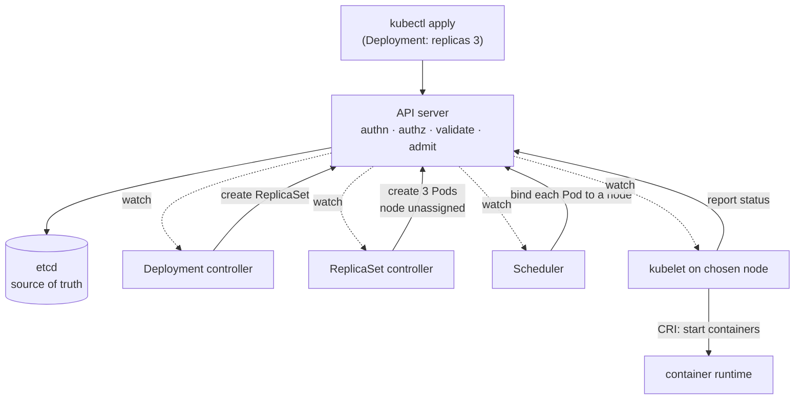

# Chapter 7: The Control Plane and the Object Model

We ended the last chapter with a promise the reconciliation loop makes but cannot
keep on its own. A control loop needs three things to exist in the world:
somewhere to durably remember the desired and current state, a way to notice when
that state changes, and the controllers themselves to run the loops. A cluster is
precisely the machine that provides those three things, plus the pieces that turn
decisions into running containers. In this chapter we name that machine, watch a
single command flow through all of it, and then, most importantly, learn the data
model every part of it speaks, because that model is where the whole idea of a
"graph of resources" is born, and with it the exact failure mode Syg exists to
close.

## Two planes

A Kubernetes cluster splits cleanly into two roles, and keeping them separate in
your head prevents a lot of confusion. The **control plane** is the brain: it makes
all the decisions, holds all the state, and runs all the reconciliation loops. The
**worker nodes** are the muscle: they are the machines where your containers
actually run, and they do as the brain instructs. Collectively the workers are
called the **data plane**: the layer that carries the actual work, as opposed to the
layer that decides about it. That split is a borrowed idea and a general one; it turns
up in network switches and in databases with the same meaning, so it is worth
recognising rather than filing under Kubernetes trivia.

The control plane decides *what* should run *where*; the nodes make it so. A small
cluster might run the control plane on the same machines as workloads; a serious one
keeps them apart, and often you never see the control plane at all because a cloud
provider runs it for you: the managed-service trade from Chapter 4, applied to the
brain itself. Either way, the split is conceptual bedrock: decisions in one place,
execution in another, connected by the object model we are about to meet.

## The components, and what each one is *for*

Let us walk the control plane, but resist the urge to memorise a list. Each
component earns its place by providing one of the three things a reconciliation
loop needs, and if you attach each name to its *job*, you will never have to
memorise anything.

**etcd** is the memory: the single source of truth. It is a distributed key-value
store, and it holds the entire state of the cluster: every object, every `spec`,
every `status`, all of it. This is worth pausing on, because it is a radical
simplification. There is exactly one authoritative record of what the cluster is
and wants to be, and it lives in etcd; every other component is, in principle,
*stateless*, holding nothing precious of its own and able to crash and restart
freely because the truth is safe in etcd. That is why etcd is the one component you
protect above all others: lose it and you have lost the cluster's mind. It earns
the right to be that source of truth by being *consistent*: etcd uses the **Raft**
consensus algorithm to replicate its data across several machines such that a
majority (a quorum) must agree before any write is accepted, so the stored state
survives the loss of a minority of its members without ever serving two conflicting
answers. When you hear that Kubernetes' desired and current state must be durable
and consistent, this is the machinery keeping that promise.

**The API server** (`kube-apiserver`) is the front door, and it is the most
architecturally important component to understand, because of a discipline it
enforces: **it is the only thing that talks to etcd.** Nothing else (no controller,
no scheduler, no kubelet, no `kubectl`) ever touches the datastore directly.
Everything goes through the API server. Every read, every write, every watch. This
is a hub-and-spoke design, not a mesh, and it is deliberate: by funnelling all
state access through one component, the system gets one place to enforce
authentication (who are you?), authorization (are you allowed?), validation (is
this object well-formed?), and admission (should this be allowed or modified on the
way in?), and it gets one coherent, guarded interface to the truth. When you run
`kubectl apply`, you are talking to the API server. When a controller creates a
Pod, it asks the API server. The entire cluster is a set of components orbiting this
one hub, communicating *only* by reading and writing objects through it, never
directly with each other. Hold onto that: the components do not call each other.
They collaborate entirely by leaving objects in the shared store for one another to
find.

Which raises the question the reconciliation loop needs answered: how does a
controller *notice* that an object it cares about has changed, without hammering the
API server with constant polling? Through the **watch** mechanism. A client opens a
long-lived watch against the API server for a kind of object, and the server streams
it a notification every time such an object is created, changed, or deleted. In
practice controllers wrap this in an *informer* that keeps a local cached mirror of
the relevant objects, kept current by the watch stream, so the controller's loop can
read "current state" instantly from local memory rather than querying etcd each
time. This is the efficient nervous system that makes level-triggered reconciliation
practical at scale: controllers are not polling in tight loops, they are watching a
change stream and reconciling in response, while still, crucially, re-listing the
full state whenever the watch stream is interrupted (and re-processing their cached
world periodically besides), so that a missed message can never cause the permanent
drift we warned about. The event stream is an optimisation; the level-triggered
guarantee never rests on it.

**The scheduler** (`kube-scheduler`) is a specialised controller with one job:
placement. Its loop watches for Pods that have been created but not yet assigned to
a node: Pods whose "where should I run?" is still blank. For each, it runs a
decision in two phases: *filtering*, which eliminates every node that cannot run the
Pod (not enough free resources, missing a required label, or carrying a **taint**,
a marker a node wears to repel Pods that have not explicitly declared they will
tolerate it), and *scoring*, which ranks the survivors by how good a fit they are
(spreading load, honouring preferences), and then it writes its choice back: it
*binds* the Pod to the winning node. Note what the scheduler does *not* do: it does
not run anything. It only decides. Placement is a hard enough problem (a
constraint-satisfaction problem over a changing fleet) to deserve its own component,
and Chapter 10 is largely about the machinery it reasons with. For now: the scheduler
turns an unplaced Pod into a placed one, and stops there.

**The controller manager** (`kube-controller-manager`) is simply the bundle that
runs the core reconciliation loops we met last chapter: controllers that manage
long-running applications, controllers that watch the health of nodes, controllers
that keep the list of a service's healthy members current, and dozens more. Each is
an independent level-triggered loop; they are packaged into one binary purely for
convenience. The next chapter introduces the specific ones you will actually write
configuration for, so the names can wait.

Down on each worker node lives the **kubelet**, and it is where the abstract
becomes physical. The kubelet is a per-node agent whose loop watches for Pods that
have been assigned (by the scheduler) to *its* node, and makes them real: it
instructs the node's **container runtime** (the software that does the actual
namespace-and-cgroup work from Chapter 5, in practice containerd or CRI-O) to pull
the images and start the containers. The kubelet then watches over them, running
their **probes** (the periodic health tests that decide whether a container should
be restarted or is fit to receive traffic, which Chapter 11 covers in full) and
continuously reporting each Pod's actual status back up through the API server. The
kubelet is the exact point where declared desired state finally becomes a running
Linux process. Alongside it on every node runs **kube-proxy**, which programs the
node's networking so that the abstract Services of Chapter 9 actually reach real Pods.

One detail about how the kubelet talks to the runtime, because it explains something
larger. It does not speak containerd's language, or CRI-O's. It speaks to whichever
is installed through a fixed API called the **Container Runtime Interface**, or
**CRI**: a defined set of calls ("pull this image," "start this container," "tell me
how this container is doing") that any runtime can implement. That indirection is not
bureaucracy. It is the reason Kubernetes survived the container-runtime churn of the
late 2010s without its users noticing: when Docker's runtime was removed from the
kubelet, clusters switched to containerd underneath and the objects people had
written did not change, because nothing above the interface ever named the thing
below it.

Watch for this pattern: Kubernetes defines an interface and lets the ecosystem
supply the implementation. It is also the shape of the storage and networking
stories, and it is the same discipline that makes what Syg emits portable across
providers.

## One command, all the way down

Now watch a single, ordinary act flow through the whole machine, because it makes
the chain of level-triggered loops from the last chapter completely concrete and you
will never forget it once you have traced it.

The act is this: you write down what you want in a file and submit it. The file is
written in **YAML** (a plain-text format for nested key–value data, the format
essentially all Kubernetes configuration is written in), and you submit it with
`kubectl`, the standard command-line client, by running `kubectl apply -f
deployment.yaml`. What the file asks for: three copies of a web server.

Trace it. Your YAML reaches the **API server**, which authenticates you, checks you
are authorized, validates the object, and persists the **Deployment** (the object
that says "keep N copies of this running," which Chapter 8 covers properly) to
**etcd**, and returns success. At this instant *nothing is running*; all that exists
is a recorded desire. The **Deployment controller**, watching, sees a Deployment
whose desired state is unmet and, doing its one job, creates a **ReplicaSet** (a
controller whose sole purpose is "keep exactly N copies of a Pod template running"),
which it does by writing to the API server, into etcd. The **ReplicaSet
controller**, watching, sees a ReplicaSet wanting three Pods and zero existing, and
creates three **Pod** objects (with no node assigned yet), again through the API
server. The **scheduler**, watching for unplaced Pods, sees three, and binds each to
a node. On each chosen node, the **kubelet**, watching for Pods bound to it, sees its
assignment and tells the **container runtime** to pull images and start containers,
and reports their status back up, through the API server, into etcd, where the
controllers watching see current state moving toward desired and keep reconciling
until the gap is closed.

Look at what just happened. No component commanded any other. Not one of them called
another directly. Each simply watched the shared store, and when it saw an object
whose desired state was unmet, it acted by writing *more* desired state for the next
controller to find: a cascade of independent, level-triggered loops, each ignorant
of the others, composing into the coordinated act of running your application. This
is the architecture from Chapter 6, made of real parts. And if a node dies now, the
Pods on it vanish from status, the ReplicaSet controller's next pass sees two where
it wants three, and the whole cascade runs again, not as recovery logic, but as the
same loops doing the same thing. You have now seen the machine breathe.

## The object model: one envelope for everything

Every one of those objects (Deployment, ReplicaSet, Pod, Service, and the hundreds
of other kinds) shares one uniform structure, and that uniformity is quietly one of
Kubernetes' greatest design decisions. Every object is the same envelope:

- **`apiVersion`** and **`kind`**: what *type* of object this is, and which version
  of its schema.
- **`metadata`**: its identity and bookkeeping: its `name`, its `namespace` (a
  virtual partition of the cluster, so that two teams can each have a service called
  `api` without colliding), its `labels` and `annotations`, and its
  `ownerReferences`, which the end of this chapter comes back to.
- **`spec`**: the desired state you declared, exactly as in Chapter 6.
- **`status`**: the current state the system observes, exactly as in Chapter 6.

Because *every* object wears this same envelope, the API server needs only one
generic machinery to store, validate, version, watch, and secure *all* of them,
and the system becomes extensible almost for free: you can teach Kubernetes an
entirely new kind of object (a Custom Resource) and it slots into the same
machinery, gains the same `spec`/`status`/watch behaviour, and can be reconciled by
your own controller, without the core knowing anything about it. The whole system is
"objects with a spec and a status, watched and reconciled." Once you see that, its
apparent sprawl collapses into a single repeated pattern.

## Labels and selectors: the universal join, and the crack in the floor

Now we reach the most important idea in this chapter for everything that follows:
the mechanism that gives Kubernetes its flexibility *and* opens the exact wound Syg
was built to close.

Objects need to refer to one another. A Service needs to know which Pods to send
traffic to; a Deployment needs to know which Pods are "its" replicas. The obvious
way to link them would be by identity: the Service holds a list of the specific
Pods it targets. Kubernetes deliberately does *not* do this. Instead it links things
through **labels** and **selectors**, and the indirection is the whole point.

A **label** is a key/value pair attached to an object's metadata; the docs call
labels "identifying attributes of objects that are meaningful and relevant to
users," things like `app: nginx` or `tier: frontend`. A **label selector** is a
query over those labels; the docs call it "the core grouping primitive in
Kubernetes," the thing that lets one resource "identify a *set* of objects." A
Service does not say "route to Pod-abc123 and Pod-def456." It says, in effect,
*"route to whatever Pods match `app=nginx`."* A Deployment does not own a fixed list
of Pods; it owns *"whatever Pods match my selector."* The link between resources is
not a reference to a specific object; it is a **query that is evaluated continuously
against whatever objects currently exist.**

One quick note on notation, because both spellings appear constantly and mean exactly
the same thing. `app: nginx` is how the pair is written in a YAML file. `app=nginx` is
how it is written when a selector is expressed as a query string: on the command
line, or in a sentence like the one above. Same key, same value, two spellings.

Feel how powerful this is. It is what makes the system so dynamic and loosely
coupled: Pods can come and go, be created and destroyed by the thousand as things
scale and heal and roll, and the Service simply keeps matching the query against
whatever is there right now; it never needs to be told about individual Pods,
because it was never coupled to them, only to a *description* of them. This
selector-based loose coupling is the connective tissue of the entire cluster, and it
is genuinely elegant.

And it is a crack in the floor. Because the link is a query rather than a checked
reference, **nothing guarantees that the query matches anything, or matches the
right thing.** A selector is, in the end, a set of strings on one object that are
hoped to correspond to a set of strings on another, and the two sets are written in
different places, often by different people or different templates, with no
mechanism anywhere that verifies they agree. A Service can perfectly legitimately
select `app: api` while the only Pods that exist are labelled `app: web`, and
Kubernetes will not complain: the object is valid, the selector is valid, the query
simply matches nothing, and the Service quietly routes to a void. This is what it
means to say the cluster is a **stringly-typed graph**: a graph whose edges are
string queries evaluated at runtime, with no compile-time guarantee that any given
edge actually connects to anything. The elegance and the danger are the same
mechanism seen from two sides.

There is a second, stronger kind of link worth naming for contrast:
**`ownerReferences`**. When the ReplicaSet controller created those three Pods, it
stamped each Pod's metadata with an owner reference pointing back at the ReplicaSet:
an *explicit, by-identity* link, used for cascading deletion (delete the
Deployment and its ReplicaSets and Pods go with it) and for controllers to
recognise their own offspring. So the cluster's object graph actually has two kinds
of edge running through it: the strong, explicit, by-identity edges of ownership,
and the loose, by-query edges of label selection. The strong ones rarely surprise
you. The loose ones, the selectors, are where the silent failures live, precisely
because they are queries that no one checks.

You are now standing exactly where Syg begins.

## Where Syg stands

Almost the entire Syg project is a response to the last two sections. This is less
"where Syg helps" than why Syg exists at all. The cluster is a
graph of objects joined by label-selector queries that nothing validates: a
stringly-typed graph whose most important edges can silently connect to nothing.
Syg's central move is to refuse to let a human write those two sides of a join
independently. In Syg you never write a selector and, separately, the labels it is
supposed to match; you declare the service *once*, and the compiler *derives* the
selector and the labels from that single value, so the query and the thing it
queries are provably, byte-for-byte the same: the edge cannot dangle because both
of its ends came from one source
([`service-selects-nothing`](../rules/prevented.md#service-selects-nothing); the
[derivation map](../derivation-map.md) lists every such field). And the "resource graph" that Syg builds internally as its
intermediate representation is, quite literally, a *typed* version of the object
graph you just met: the same nodes, the same edges, but with the loose string-query
edges replaced by checked, resolved references. Everything the language does is,
underneath, an attempt to give this graph the integrity that the runtime object
model, for all its elegance, deliberately leaves unguarded.

## Read the source

- **Kubernetes Components**: the authoritative tour of the control plane and node
  components: https://kubernetes.io/docs/concepts/overview/components/
- **Labels and Selectors**: the primary description of labels as identifying
  attributes and selectors as the core grouping primitive:
  https://kubernetes.io/docs/concepts/overview/working-with-objects/labels/
- **Kubernetes objects** (`spec` and `status`, the shared envelope):
  https://kubernetes.io/docs/concepts/overview/working-with-objects/
- **etcd** and its use of the **Raft** consensus algorithm: https://etcd.io/docs/
  and the Raft paper, https://raft.github.io/

---

*You now know the machine and the language it speaks. It is time to look closely at
the objects that matter most to you as someone shipping software: the workloads
(the Pod and the controllers that manage Pods), including the one field whose
immutability, if you cross it, breaks a running system in a way that is genuinely
hard to undo.* → [Workloads](../notes/08-workloads.md)
