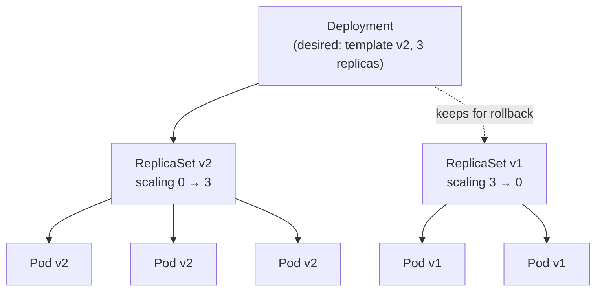

# Chapter 8: Workloads

We have built the machine and learned its language. Now we come to the part you
actually care about as someone who ships software: *how does my code run, and stay
running?* The answer is a small family of object kinds, the **workload
controllers**, and to use them well you have to understand not just what each one
does but *why there are several*, because the differences between them are the
differences between kinds of software, and choosing wrong is a category error that
hurts in production. Along the way we will meet the one field in all of Kubernetes
whose immutability, if you disregard it, breaks a running system in a way that is
genuinely painful to undo, and which turns out to be the reason Syg pins a certain
decision forever.

## The Pod: the atom you don't actually manage

Everything starts with the **Pod**, and there is a common misconception to clear
first: a Pod is not "a container." A Pod is *one or more* containers that are
treated as a single unit: scheduled together onto one node, living and dying
together, and sharing two things that make them a genuine unit rather than a
coincidental grouping.

The first shared thing is the **network namespace**. Recall from Chapter 5 that a
network namespace is a private network stack: interfaces, IP, ports. Every
container in a Pod shares *one* network namespace, which means they share one IP
address and can reach each other over `localhost`, as if they were processes on the
same machine, while to the outside world the whole Pod presents as a single network
identity. (Mechanically, the kubelet creates the namespace via a tiny placeholder
"pause" container that does nothing but hold it open, and the real containers join
it.) The second shared thing is **storage**: containers in a Pod can mount the same
volumes and so share files.

Why would you want more than one container in this tight embrace? The canonical
reason is the **sidecar** pattern: a main application container accompanied by
helper containers that must be co-located with it and share its network or disk: a
proxy that intercepts its traffic, a log shipper that reads its files, an agent that
refreshes its credentials. These helpers are not separate services; they are part of
*this* instance, and they need to be *right next to* the main container, on the same
node, sharing the same localhost and the same disk. The Pod is the boundary that
makes "these containers are one deployable unit" a first-class concept. It is the
smallest thing Kubernetes schedules: you never place a container, you place a Pod.

Now the crucial property, which follows directly from Chapter 5's immutability:
**a Pod is mortal.** Be precise about what that does and does not mean, because
there is one repair the system genuinely performs in place: if a *container*
inside a Pod crashes, the kubelet restarts that container according to the Pod's
**`restartPolicy`**, a field on the Pod with three possible values: `Always` (the
default: restart the container whenever it stops, for any reason), `OnFailure`
(restart only if it exited with an error), and `Never`. The result is the same
Pod, same name, same IP, a restart counter ticking upward. That is container-level
healing, local to the node, and it is as far as in-place repair ever goes.

The *Pod itself* is never resurrected. When the Pod is lost (its node dies, it is
evicted, it is deleted), nothing anywhere revives *that* Pod. If something replaces
it, the replacement is a brand-new Pod with a new name, a new IP, and a new identity,
and the old one is gone for good. A Pod is a cattle-not-pets unit all the way down,
which is why you should almost never create one directly, and that leads straight to
the controllers.

## Why a bare Pod is not enough

Suppose you create a Pod directly: just a Pod object, nothing else. It gets
scheduled, it runs. Now its node catches fire. The Pod vanishes from the cluster's
state, and… nothing happens. There is no loop watching to say "you wanted this Pod
and now it is gone, so make another." A bare Pod is desired state that no controller
is reconciling on your behalf: it exists, but nothing is *guarding* its existence.
Worse, "I want this exact one Pod" is almost never what you actually want. You want
*three healthy copies at all times*, or *one copy on every node*, or *this batch job
run to completion*. Those are statements about a *set* whose membership should be
continuously maintained against failure, which is to say, they are exactly the jobs
for a reconciliation loop, and each one has a controller.

The workhorse loop is the **ReplicaSet**: its entire purpose is to keep a specified
number of identical Pods (matching its label selector) running at all times. Its
loop is the one we traced in Chapter 7: count the Pods matching my selector, compare
to my desired count, create or delete to close the gap, forever. If a Pod dies, the
next pass makes a replacement. That is your self-healing replica count, and it is
beautifully simple. But you will rarely create a ReplicaSet by hand either, because
on its own it cannot do the one thing you need constantly: change the software
without downtime.

## The Deployment: rolling change without an outage

The **Deployment** is the object you will actually use for ordinary stateless
services, and it exists to manage ReplicaSets so that you get *declarative updates
and rollbacks* on top of the replica-count guarantee. The ownership runs in a chain:
a Deployment owns one or more ReplicaSets, and each ReplicaSet owns its Pods.

Here is the mechanism, which the documentation states plainly: a Deployment's
rollout "is triggered if and only if the Deployment's Pod template … is changed",
so scaling up or down does *not* cause a rollout, but changing the container image
or any other part of the template *does*. When it does, the Deployment "gradually
scales [a new ReplicaSet] up while scaling down the old ReplicaSet, ensuring Pods are
replaced at a controlled rate." Read that as reconciliation, because that is all it
is: you change the desired template; the Deployment controller creates a *new*
ReplicaSet carrying the new template, and then drives two numbers (the new
ReplicaSet's replica count up, the old one's down) one step at a time, watching the
new Pods become healthy before continuing, until the new ReplicaSet holds all the
replicas and the old holds none. The old ReplicaSet is not deleted; it is left
scaled to zero, *so that a rollback is just the same dance in reverse*: scale the
old one back up, the new one down. Zero-downtime deploys and instant rollbacks are
not special subsystems; they are a controller moving two replica counts around.

Two knobs govern how aggressively this happens, and one of them reappears in
Chapter 11 as a trap. **`maxSurge`** is how many Pods *above* your desired count
the rollout may create temporarily (extra capacity to bring up new Pods before
retiring old ones), and **`maxUnavailable`** is how many *below* your desired count
it may drop to during the transition. Together they trade rollout speed against
capacity headroom: allow more surge and it goes faster but uses more resources;
allow more unavailability and it goes faster but runs closer to the edge. Set
`maxUnavailable` carelessly and a routine deploy can thin your fleet below what your
traffic needs: a self-inflicted capacity incident hiding inside a "safe" rolling
update.

## The immutable selector: the landmine under the workload

This is the field the previous chapter's closing line was pointing at: the one
whose immutability, crossed, breaks a running system in a way that is genuinely
hard to undo. It is also the reason a certain design decision in Syg is treated as
sacred.

A Deployment (and its ReplicaSet) owns its Pods through the same mechanism as
everything else in Chapter 7: a **label selector** matching the labels on the Pod
template. The documentation is explicit that these two must agree: the selector in
`.spec.selector` and the labels in `.spec.template.metadata.labels` have to match,
or the controller cannot recognise the Pods it is supposed to own. And here is the
sharp edge: **`.spec.selector` is immutable.** Once a Deployment (or StatefulSet)
exists, the API server rejects any attempt to change its selector, and the docs
flag "label selector updates" as a discouraged, hazardous operation for good reason.

*Why* would a system forbid you from changing a field? Sit with it, because the
reasoning is the whole lesson. The selector *defines which Pods are mine.* Suppose
you could change it. The moment you did, the Pods that are currently running (which
carry the *old* labels) would no longer match the *new* selector. In an instant,
the controller would look out, see zero Pods matching its (new) selector, and
conclude it has none, so it would create a fresh full set, while the old Pods,
now matching nothing, keep running as orphans that no controller owns, manages, or
will ever clean up. A single live workload would silently *fork* into two: a set of
abandoned old Pods still serving traffic, and a set of new Pods the controller
thinks are the whole story. That is a catastrophic, hard-to-diagnose state, and
making the selector immutable is how Kubernetes refuses to let you enter it. The
field is not immutable to annoy you; it is immutable because mutating it corrupts
the ownership graph of a running system.

This has a consequence that reaches directly into how you must build *tooling* that
generates Kubernetes objects, and it is the exact reason for one of Syg's most
carefully guarded decisions. If a tool generates the label scheme that becomes a
Deployment's selector, then that scheme is, from the first `apply` onward,
*welded to every live workload it produced*, and the tool can never change how it
computes those labels, ever, without the next deploy either being rejected or
orphaning Pods across the entire fleet. A generated selector is a permanent,
load-bearing decision made once and honoured forever, and that is not a stylistic
preference anyone chose. It is this immutability rule, propagating upward into the
design of anything that writes selectors on your behalf.

## One shape does not fit all: the specialised controllers

The Deployment is right for *stateless* software: interchangeable copies where any
replica is as good as any other and Pods can be created, destroyed, and replaced in
any order. A great deal of software is not like that, and Kubernetes provides three
more workload controllers for the shapes that don't fit, each differing in what
"desired state" even means.

A **StatefulSet** is for workloads that need **stable identity and stable,
per-replica storage**: databases, message brokers, anything where the replicas are
*not* interchangeable because each one owns a distinct piece of durable state.
Where a Deployment's Pods get random names and are fungible, a StatefulSet's Pods
get *stable, ordinal* identities (`db-0`, `db-1`, `db-2`) that persist across
rescheduling: if `db-1` dies, its replacement is *also* `db-1`, with the same stable
network name and, critically, *the same persistent volume reattached.* A StatefulSet
creates and destroys its Pods in order, and, through a `volumeClaimTemplate`, gives
*each* replica its own separate persistent disk that follows that identity around.
The difference from a Deployment is not cosmetic; it is the difference between "any
replica will do" and "replica 1 is *the* replica that owns *this* data," and using a
Deployment where you needed a StatefulSet is how you get replicas fighting over one
disk or losing their state on reschedule.

A **DaemonSet** ensures **one copy of a Pod on every node** (or every node in a
chosen subset): the shape you want for things that are properties of the *machine*
rather than the *application*: a log collector that ships each node's logs, a
monitoring agent, the networking component that wires up the node. Its desired state
is not "N copies" but "exactly one per node," and its loop reacts to nodes joining
and leaving: add a node to the cluster and the DaemonSet automatically places its
Pod there; remove one and the Pod goes with it.

A **Job** runs a Pod (or several) **to completion**: batch work that finishes,
rather than a service that runs forever. Its notion of success is inverted from
everything else: for a service, a Pod entering `Succeeded` (exiting cleanly) would
be a problem; for a Job, it is the *goal*. A Job runs its Pods, retrying failures up
to a limit, until the required number have completed successfully, and then it is
done. A **CronJob** wraps a Job in a schedule, creating a new Job on a cron
timetable: the Kubernetes-native way to run periodic batch work. These share a
lifecycle model with the others (Pods, reconciliation) but a completely different
success condition, which is why they are their own kinds.

Step back and the family makes sense as *four answers to "what does staying in
desired state mean for this software?"* For a stateless service, it means *N
interchangeable copies* (Deployment). For stateful software, *N stable-identity
replicas each with its own disk* (StatefulSet). For a node-level agent, *one copy
per machine* (DaemonSet). For batch work, *run until it completes* (Job/CronJob).
Choosing the controller is choosing the shape of your workload's relationship to
failure and change.

## Where Syg stands

Syg's top-level workload declarations map onto exactly this family (a `service`
becomes a Deployment, a `stateful` a StatefulSet, a `job` a Job or CronJob), so that
choosing the right controller becomes choosing the right *word*, with the meaning
made explicit rather than buried in a `kind:` field. But the deepest connection in
this chapter is the immutable selector. Because a generated selector is welded
forever to every workload it produces, Syg treats its derived label scheme as a
permanent, compatibility-critical decision: it is fixed once, guarded by a
regression test, and any change to it is a breaking change requiring a major version
and a migration. And the requirement the docs state (that a Deployment's selector
and its Pod-template labels must match) Syg makes *unbreakable* rather than merely
checked: both are derived from one value, so they are byte-for-byte identical and
cannot drift apart
([`selector-template-mismatch`](../rules/prevented.md#selector-template-mismatch)). The
landmine you just learned about is one Syg defuses by never letting you near the
trigger.

## Read the source

- **Pods** and the **Pod lifecycle** (phases, container states, restarts):
  https://kubernetes.io/docs/concepts/workloads/pods/ and
  https://kubernetes.io/docs/concepts/workloads/pods/pod-lifecycle/
- **Deployments**: rolling updates, `maxSurge`/`maxUnavailable`, and the
  label-selector cautions: https://kubernetes.io/docs/concepts/workloads/controllers/deployment/
- **StatefulSets**: https://kubernetes.io/docs/concepts/workloads/controllers/statefulset/
- **DaemonSets**: https://kubernetes.io/docs/concepts/workloads/controllers/daemonset/
- **Jobs** and **CronJobs**: https://kubernetes.io/docs/concepts/workloads/controllers/job/
  and https://kubernetes.io/docs/concepts/workloads/controllers/cron-job/

---

*Your workloads are now running and self-healing, but every time a Pod is replaced
it gets a new IP, and there may be dozens of replicas coming and going every minute.
So how does anything reliably talk to your service when its very location is in
constant flux? That is the problem of service discovery, and solving it is where the
elegant, dangerous machinery of labels and selectors does its most important (and
most silently breakable) work.* →
[Networking and service discovery](../notes/09-networking-and-service-discovery.md)
