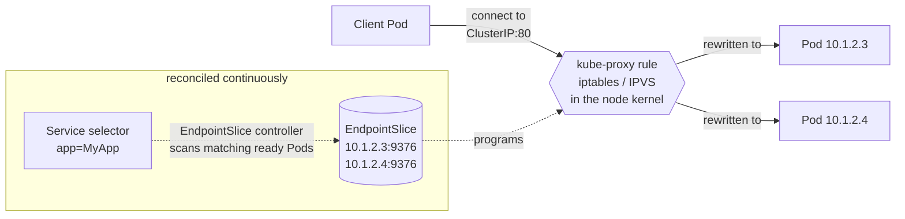

# Chapter 9: Networking and Service Discovery

Here is a problem that sounds simple and is not. Your frontend needs to talk to
your backend. The backend is a Deployment with several replicas, each a Pod with
its own IP. But those Pods are mortal (they crash, they get rescheduled, they are
replaced during every deploy), and each replacement comes up with a *new* IP. The
set of backend Pods that exists right now, and the addresses they hold, is in
constant flux, changing many times an hour under normal operation. So the frontend
cannot simply be told "the backend is at 10.1.2.3," because that address will be
wrong within minutes, and it cannot be told the whole list, because the whole list
is a moving target.

This is the problem of **service discovery**: how does one part of a system reliably
find and reach another part whose location is perpetually changing? Kubernetes'
answer is elegant, and it is built, as you might now guess, on labels and
selectors, which means it is also the place where the "stringly-typed graph" from
Chapter 7 does its most important work and suffers its most silent, most common
failure. By the end of this chapter you will understand a specific production
incident (the "dangling service," where everything is healthy and nothing works)
so precisely that you could have designed the check that prevents it. Which is
convenient, because someone did.

## The foundation: a flat network where every Pod is a first-class citizen

Before Services, understand the ground they stand on, because Kubernetes makes a
strong and deliberate promise about the network that is easy to take for granted.

The Kubernetes network model requires that **every Pod gets its own unique,
cluster-wide IP address**, and that **any Pod can reach any other Pod directly, by
that IP, with no network address translation**: across nodes, as if the entire
cluster were one flat network. The docs state the requirement plainly: "Each Pod
gets its own IP address (Kubernetes expects network plugins to ensure this)," and
Pods "communicate directly with each other without NAT." Containers *within* a Pod
share that one IP and reach each other on `localhost`, exactly as Chapter 8
described; containers in *different* Pods reach each other on the Pods' IPs, whether
those Pods are on the same machine or opposite ends of the cluster.

Notice the phrasing "Kubernetes expects network plugins to ensure this." Kubernetes
does not *implement* this network itself. It *demands* it as a contract and delegates
the fulfilment to a pluggable networking layer, a **CNI** (Container Network
Interface) plugin like Calico, Cilium, or a cloud provider's own, whose job is to
make the flat-network promise real, wiring up each Pod's network namespace and
routing packets between nodes. This is a recurring Kubernetes move: define a clean
contract, let a plugin satisfy it. For our purposes the important thing is the
*shape* of the promise: a flat space where every Pod is directly addressable. It is
a beautiful simplification (no port-mapping gymnastics, no "which host is it on"
bookkeeping), and it is the canvas on which service discovery is painted.

But the flat network gives us Pod IPs, and Pod IPs are exactly the ephemeral,
untrustworthy things we cannot build on. We need something stable in front of them.

## The Service: a stable handle over a shifting set

A **Service** is that stable thing. The docs describe it as "a method for exposing a
network application that is running as one or more Pods," and its core gift is
*decoupling*: it gives you a single, stable point of contact (a virtual IP and a
DNS name that *never change for the life of the Service*) standing in front of a
set of Pods that changes constantly underneath. Clients talk to the Service and
never think about individual Pods at all; the Service is responsible for spreading
their traffic across whatever Pods currently back it.

That stable virtual IP is called the **ClusterIP**: "Kubernetes assigns this Service
an IP address (the cluster IP), that is used by the virtual IP address mechanism." A
client connects to, say, `10.0.0.5:80` (the Service's ClusterIP and port), and its
request is delivered to one of the live backend Pods, without the client ever
knowing which Pod, or that the set of Pods changed three times while it was making
requests. Alongside the IP, the Service gets a stable **DNS name**,
`my-service.my-namespace.svc.cluster.local`, served by the cluster's DNS (CoreDNS),
so clients can use a stable *name* rather than even the IP. Service discovery, at
the level you write code against, is often just: connect to the name, and trust
Kubernetes to route it.

And how does a Service know which Pods back it? By exactly the mechanism of
Chapter 7: **a label selector.** The Service carries a selector (say
`app.kubernetes.io/name: MyApp`), and its backends are, by definition, "whatever
Pods match that selector." The Service is not coupled to any specific Pods; it is
coupled to a *description*, and the system continuously re-evaluates that description
against reality. Which brings us to the machinery that makes it live.

## The mechanism, exactly

Three moving parts turn "a selector" into "traffic reaching healthy Pods." Trace
them, because their seams are where the failure lives.

First, the **EndpointSlice controller**. This is a reconciliation loop of the shape
you now know cold. The docs: "The controller for that Service continuously scans for
Pods that match its selector, and then makes any necessary updates to the set of
**EndpointSlices** for the Service." An EndpointSlice is simply the materialised
answer to the selector query: the current list of IP addresses of the *ready* Pods
that back this Service. As Pods are created, destroyed, become ready, or fail, the
controller updates the EndpointSlices to match, automatically and continuously. The
ephemeral, shifting set of backend Pod IPs is thereby captured, live, in a concrete
object that always reflects *who is actually available right now*. Note that word
*ready*: only Pods that have passed their **readiness check** (a health test the
system runs against each Pod to decide whether it is fit to receive traffic) are
included here. Chapter 11 is largely about those checks and the surprising ways they
fail.

Second, **kube-proxy**. Recall from Chapter 7 that a copy runs on every node. It
watches Services and their EndpointSlices through the API server, and it programs the
node's *kernel*, so that any packet destined for a Service's ClusterIP is
transparently rewritten to the address of one of the Pods in that Service's
EndpointSlices.

It does that through one of two Linux facilities, and you will hear both named.
**`iptables`** is the long-standing packet-filtering and address-rewriting engine
built into the kernel: you install rules, and every packet is matched against them as
it passes. **IPVS** (IP Virtual Server) is a kernel module built specifically for load
balancing, which keeps its backends in a hash table rather than a rule list and so
stays fast as the number of services grows. Which one your cluster uses changes the
performance profile (and one detail of the failure we are about to meet), but not the
idea.

Now, why is the ClusterIP called *virtual*? Because nothing is listening at
`10.0.0.5`. In iptables mode no interface holds that address at all; in IPVS mode it
is parked on a local dummy device purely so the kernel will accept packets for it,
but in neither case is there a process behind it. It is less an address than a
*promise*, kept by kernel rules on every node that say "if you see traffic for this
ClusterIP, send it to one of these real Pod IPs instead." The load-balancing across
backends happens down in the kernel, invisibly, with no cooperation from your
application, which believes it simply opened a connection to `10.0.0.5` and got an
answer.

Put the path together:

A client connects to the stable ClusterIP; a kernel rule on its node rewrites the
destination to a currently-ready backend Pod; and the set of currently-ready backend
Pods is kept accurate, moment to moment, by an EndpointSlice controller reconciling
the Service's *selector* against the Pods that exist. Stable handle in front, shifting
reality behind, a continuously-reconciled query joining them. It is the reconciliation
loop and the selector-based graph, working in concert to solve a genuinely hard
problem with real grace.

And now you can see precisely where the grace fails.

## The dangling service

Everything above hangs on one thread: the selector matching the *right* Pods. Pull
that thread and watch what happens, because this is the archetypal Kubernetes
production incident, and you are about to understand it better than most people who
have fought it at 3 a.m.

Suppose the Service's selector says `app: api`, but the Pods that actually exist are
labelled `app: web`, because someone renamed the app on one side and not the other,
or a template set the Service's selector and the Deployment's Pod labels from two
different values that drifted apart, or there was simply a typo. What happens?

The EndpointSlice controller does its job faithfully: it scans for Pods matching
`app: api`, finds *none*, and maintains an EndpointSlice that is **empty**.
kube-proxy does its job faithfully too, and here the mechanics are worth being
exact about: for a Service with no ready endpoints, kube-proxy in its common
iptables mode installs a rule that outright *rejects* traffic to that ClusterIP,
so the client's connection attempt comes back `connection refused`, immediately,
from a Service that looks perfectly configured. (Depending on the proxy mode and
the path the traffic takes, the failure can also surface as a timeout instead;
the constant is that nothing answers, because there is nothing to answer.)
Either way, requests fail, and no component anywhere reports an error, because
no component did anything wrong.

Now feel the specific cruelty of this failure, because it is what makes it so
expensive. *Nothing is broken, individually.* The Service object is valid: it
passed every schema check, it has a ClusterIP, it looks perfect in every dashboard.
The Pods are valid: they are healthy, running, passing their own health checks,
serving requests happily to anyone who reaches them directly. Every *object* is
fine. What is broken is the *relationship between them* (the selector query that was
supposed to connect the Service to the Pods matches nothing), and no object owns that
relationship, so no object's validation can catch it. You deploy, everything reports
green, and requests are simply refused. You stare at a healthy Service and healthy Pods and
cannot see the problem, because the problem is not *in* either of them; it is in the
*edge* between them, and the edge is an unchecked string query evaluated silently at
runtime.

This is the stringly-typed graph from Chapter 7, no longer an abstraction but a
pager alert. It is the purest possible illustration of why "every resource is valid"
is a dangerously incomplete notion of correctness in Kubernetes: the resources can
all be valid while the *graph they form* is broken, and it is the graph (the
relationships, the edges, the selector queries and name references) where
production actually lives and dies.

## Getting in from the outside: north-south traffic

One more layer, because it multiplies the same pattern. Everything so far is what the
industry calls **east-west** traffic: traffic that stays *inside* the cluster, Pod to
Pod through Services. Traffic that crosses the boundary (a user's browser reaching
in from outside, or your service calling an external API) is **north-south**. The
names come from the way architecture diagrams are conventionally drawn, with the
outside world at the top and bottom and the internal fleet spread left to right; they
are worth knowing because everyone uses them and nobody explains them. Letting the
outside world in takes more than what we have built so far.

A ClusterIP Service is internal-only; its virtual IP means nothing outside the
cluster. To expose a service externally you can escalate the Service's type (a
`NodePort` opens a port on every node; a `LoadBalancer` asks the cloud for a real
external load balancer), but for HTTP the idiomatic tool is the **Ingress** (and its
modern successor, the **Gateway API**): a routing layer that maps external hostnames
and URL paths to internal Services. An Ingress rule says, in effect, "requests for
`shop.example.com/api` go to the Service named `api-svc` on port `http`."

And look at what that rule *is*: a chain of references. The Ingress names a backend
**Service by string** (`api-svc`), which in turn selects **Pods by query**
(`app: api`), which listen on a **named port** that must actually exist on the
container. Every link in that chain is another unchecked edge that can dangle. Name a
backend Service that does not exist, or misspell it, and external requests get a 502
or 503. Reference a port the Service does not actually expose, and the same. The
north-south path is the east-west graph with *more* string-references stacked on
top: more edges, each individually valid, any of which can silently point at
nothing while every object involved reports perfect health. The failure mode does
not change as you add layers; it *compounds*.

## The shape of it all

Step back and see the whole network as what it is: a graph of **stable handles**
(Services, Ingresses, DNS names) standing in front of **shifting sets** of mortal
Pods, connected by **selector queries and string references** that are evaluated
continuously at runtime and validated by *nothing*. That design is what gives
Kubernetes its extraordinary dynamism: the reason a fleet of Pods can churn
constantly while clients sail on undisturbed. It is also, in the very same stroke,
the reason a healthy-looking cluster can quietly route traffic into a void. The
flexibility and the fragility are not two features to be traded against each other;
they are one mechanism seen from two sides.

## Where Syg stands

This chapter is the clearest statement of the problem Syg was built to solve. Every
dangling edge you just met (a Service selecting no Pods, an Ingress naming a Service
that does not exist, a route pointing at a port that was never declared) is, in Syg,
*unrepresentable*, because Syg refuses to let you write the two ends of an edge
independently.

You never write a Service selector at all; it is derived from the service
declaration, from the same value as the Pod labels, so the query and the Pods it
queries are guaranteed identical and the EndpointSlices can never come up empty for a
service you defined
([`service-selects-nothing`](../rules/prevented.md#service-selects-nothing)). You never write an Ingress
backend as a string; the `expose` construct *references* a named port on a declared
service, and that reference is resolved at compile time: a typo is a
name-resolution error pointing at your source line, not a 503 in production three
weeks later ([`route-backend-missing`](../rules/prevented.md#route-backend-missing),
[`route-port-missing`](../rules/prevented.md#route-port-missing),
[`service-port-unmapped`](../rules/prevented.md#service-port-unmapped)). The runtime leaves these edges
unchecked deliberately, because at runtime loose coupling is exactly what you want.
Syg's whole bet is that *at authoring time* the same edges can be made rigid
(derived from single sources so they cannot disagree), and that you give up none of
the runtime dynamism by doing so.
Loose where it must be, rigid where it is free.

## Read the source

- **Service**: the ClusterIP virtual IP, selectors, and the empty-endpoints
  behaviour: https://kubernetes.io/docs/concepts/services-networking/service/
- **EndpointSlices**: the reconciled record of ready backend Pod IPs:
  https://kubernetes.io/docs/concepts/services-networking/endpoint-slices/
- **Virtual IPs and Service Proxies**: how kube-proxy programs iptables/IPVS:
  https://kubernetes.io/docs/reference/networking/virtual-ips/
- **The Kubernetes network model** and **CNI**:
  https://kubernetes.io/docs/concepts/services-networking/
- **Ingress** and the **Gateway API**, for north-south HTTP routing:
  https://kubernetes.io/docs/concepts/services-networking/ingress/ and
  https://kubernetes.io/docs/concepts/services-networking/gateway/
- **DNS for Services and Pods**:
  https://kubernetes.io/docs/concepts/services-networking/dns-pod-service/

---

*This closes the foundational spine: from the kernel up, you now know what a container
is, the one idea that animates the whole system, the machine that runs it, how
workloads are managed, and how anything finds anything across a network in perpetual
flux. What you have not yet asked is what happens when that machine runs short: when
memory runs out and something has to be killed, and someone has to have decided in
advance whether it is your service or the one next to it. The answer is written in
two numbers most people copy without reading.* →
[Resources, scheduling, and autoscaling](../notes/10-resources-scheduling-and-autoscaling.md)
