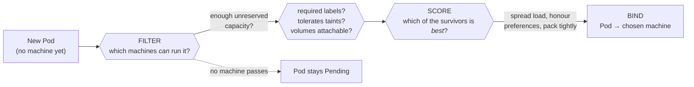

# Chapter 10: Resources, Scheduling, and Autoscaling

Here is a failure that makes people distrust the whole system the first time it
happens to them.

You have two programs running on the same machine. One of them has a memory leak and
is slowly eating everything. The other one is your service: well-behaved, using a
modest and steady amount of memory, doing its job. The machine runs out of memory.
And the one that gets killed is *yours*.

That feels like an injustice, and the temptation is to conclude the system is
arbitrary or broken. It is neither. What happened is a set of rules operating
exactly as designed on information you did not give it, and once you understand
those rules, not only does the behaviour become obvious, it becomes *controllable*.
Getting this right is one of the sharpest lines between people who deploy software
and people who operate it.

The whole chapter comes down to two numbers you can write on a container, and what
the system does with them.

## The two numbers

Every container can declare two things about each resource it uses (processor time
and memory being the two that matter most):

A **request** is what the container is saying it *needs*. Its primary job is not to
restrict you at all; it is to inform placement. When the system looks for a machine
to run your Pod on, it adds up the requests of everything already on each candidate
machine and asks whether yours will still fit. The request is a *reservation*: this
much is set aside for you, and the system promises not to pack the machine so
tightly that you cannot have it.

A **limit** is the ceiling. It is what the container may *never exceed*, and it is
enforced by the operating system through the control-group machinery Chapter 5
described, with the crucial asymmetry that chapter established. Memory cannot be
compressed: a program that needs a byte it cannot have cannot be politely slowed
down, so when a container reaches its memory limit and the kernel cannot reclaim
enough, the kernel *kills* it. Processor time is entirely different, because it
*can* be compressed: a container that wants more processor than its limit allows is
simply made to wait (**throttled**), its threads frozen until the next scheduling
window opens. Nothing dies; things just get mysteriously slow.

That asymmetry is worth carrying with you as a diagnostic instinct. **Memory
pressure shows up as things dying. Processor pressure shows up as latency.** If your
service is being killed, look at memory. If it has gone inexplicably sluggish while
using "only 60% of its CPU limit" on a dashboard, look for throttling: the average
hides the fact that it was frozen for milliseconds at a time, repeatedly.

So: request is what you reserve, limit is what you may not exceed. Two numbers, two
completely different jobs. Now watch what the system builds out of them.

## Quality of Service: a label you do not write

From those numbers alone, Kubernetes derives a classification for every Pod, called
its **QoS class** (*quality of service*). You never set it. It is computed, and the
rules are exact:

- If **every** container in the Pod has both a memory limit and a memory request,
  and they are *equal*; and both a processor limit and request, also *equal*, the
  Pod is **Guaranteed**. You have asked for precisely what you will be held to.
- If the Pod does not qualify as Guaranteed but at least one container has *some*
  request or limit for memory or processor, it is **Burstable**. It has a floor it
  can rely on and headroom it can use when the machine is quiet.
- If **no** container has any request or limit at all, the Pod is **BestEffort**. It
  has asked for nothing, and it has been promised nothing.

Notice what BestEffort really means, because it is the crux of the opening failure.
A BestEffort Pod has made no claim on the machine. The system set nothing aside for
it. When it runs, it runs on whatever happens to be spare.

## Eviction: what actually happens when a machine runs short

Now the mechanism people most often get wrong, and getting it right is what turns
the opening story from an injustice into an obvious consequence.

When a machine starts running low on memory (or disk, or process IDs), the agent on
that machine (the kubelet) does not wait for the kernel to start killing things at
random. It steps in first and deliberately removes Pods to reclaim resources, a
process called **node-pressure eviction**. The question is: which Pods?

The folk answer, which you will hear constantly, is "BestEffort first, then
Burstable, then Guaranteed." That is a good *prediction* of the outcome, and it is
how the QoS documentation summarises it. But it is not the rule the kubelet actually
applies, and the difference matters. The real ranking works like this:

**First, and most importantly: is the Pod using more than it requested?** The kubelet
does not evict Pods whose usage is within their requests. That is the promise the
request made, and the system keeps it. Pods that are *over* their requests become the
candidates.

**Then, among those candidates, Pod Priority** (an explicit numeric importance you
can assign) decides who goes first, lowest priority first.

**Then, how far over its request the Pod is.** Among equally-prioritised offenders,
the one most egregiously above what it asked for is evicted before the one barely
over.

Guaranteed Pods, and Burstable Pods that are living within their requests, are
evicted *last*, and only by priority, when there is nothing else left to reclaim.

Now re-read the opening failure. Your well-behaved service declared no memory
request, so its request was effectively zero, which means *any* memory it used at
all put it "over request," making it a first-class eviction candidate. The leaking
neighbour, if it had declared a generous request, could sit there consuming memory
*within* its declared reservation and be protected. The system was not being
arbitrary. It killed the Pod that had made no claim, and protected the one that had.
**You were not outbid; you never bid.**

This is why "just leave requests off, the container will use what it needs" is one
of the most expensive pieces of folk wisdom in this field. Leaving requests off does
not make your Pod flexible. It makes it *first in line to die*, and simultaneously
invisible to the placement logic we are about to meet.

## Placement: how the system chooses a machine

A newly created Pod has no machine assigned to it. Something has to choose, and that
something is the **scheduler**, the control-plane component Chapter 7 introduced.
Its loop watches for Pods with no machine yet, and for each one runs a decision in
two distinct phases.

**Filtering** eliminates every machine that *cannot* run this Pod. The most important
filter is capacity, and here is the detail that surprises people: the scheduler
compares your Pod's **requests** against each machine's *unreserved* capacity: the
machine's total minus the sum of the requests of everything already placed there. It
does **not** look at how much memory the machine is actually using right now. A
machine can be sitting at 10% real utilisation and still refuse your Pod, because
the Pods already on it have *reserved* the rest through their requests. Reservations,
not measurements. Other filters check whether the machine has labels the Pod demands,
whether the Pod tolerates the machine's taints (the repelling markers from Chapter 7),
and whether its storage can be attached there.

**Scoring** ranks the machines that survived, according to how good a fit each is:
spreading load across machines, honouring preferences you have expressed, packing
efficiently. The highest scorer wins, and the scheduler *binds* the Pod to it: it
writes the choice back through the API server, and the agent on that machine picks it
up and starts the containers.

And if no machine passes the filter, the Pod does not fail. It sits in **Pending**,
and the scheduler retries, because a machine may free up or be added later. A Pod
stuck Pending is one of the most common things you will debug, and now you know the
first question to ask: *what did it request, and does any machine have that much
unreserved?* A Pod requesting more memory than any single machine has will wait
forever, patiently, with no error: desired state that can never be reconciled.

## Autoscaling: adding copies automatically, and the silent failure

Everything so far assumes you decided how many copies to run. You often do not want
to decide that by hand, because traffic varies, so the system can adjust the number
for you. The mechanism is the **Horizontal Pod Autoscaler**, usually just "the
autoscaler," and *horizontal* means it adds and removes **copies** (as opposed to
*vertical* scaling, which makes each copy bigger; there is a Vertical Pod Autoscaler
for that, which resizes requests instead of counts).

It is a reconciliation loop like everything else: it watches a measurement, compares
it to a target you set, and adjusts the number of copies to close the gap. You say
something like "keep average processor utilisation at 70%, using between 4 and 20
copies," and the loop computes roughly `desired = current × (actual ÷ target)` and
writes the new count. Utilisation rises above target, copies are added; it falls,
copies are removed.

Now the important part, and the reason this chapter puts autoscaling next to
requests rather than in a chapter of its own.

**What does "70% utilisation" mean?** It has to be a percentage *of something*. That
something is the **request**. The autoscaler takes the Pod's actual measured usage
and divides it by the amount that Pod *requested*; the docs are explicit that the
controller "calculates the utilisation value as a percentage of the equivalent
resource request on the containers in each Pod."

So the request is not just a reservation and an eviction shield. It is also the
**denominator of your autoscaling**.

And now you can predict the failure before I describe it. If a container has no
processor request, there is no denominator. The utilisation of that Pod is not zero:
it is *undefined*. And the documentation states the consequence plainly: if some of
a Pod's containers lack the relevant request, "CPU utilization for the Pod will not
be defined and the autoscaler will not take any action for that metric."

Sit with how bad that failure mode is. Your autoscaler exists. It is configured. It
appears in every dashboard and listing as present and healthy. It has a sensible
target and sensible bounds. And it will *never scale your service*, no matter how
overwhelmed it becomes, because one field is missing from a completely different
object. Nothing errors. Nothing warns. You discover it during your first traffic
spike, which is the worst possible moment to discover anything.

Which is the dangling service from Chapter 9 again, wearing different clothes. A
missing request is not just a missing request. It is a broken denominator four
objects away.

## What this chapter really taught you

One field, the request, turned out to do four different jobs:

1. It reserves capacity, so the machine is not overpacked.
2. It determines where your Pod can be placed at all.
3. It decides, under pressure, whether your Pod is protected or first to be killed.
4. It is the denominator that makes utilisation-based autoscaling function.

Which is why "we'll set resources later" is never the small deferral it sounds like.
Leaving requests off does not defer a decision; it silently makes four of them, all
badly.

## Where Syg stands

Two of Syg's checks live exactly here, and you can now see precisely why they exist.
The first flags a container that declares no processor or memory request at all
([`missing-requests`](../rules/resources.md#missing-requests)), not as style advice, but because you now know exactly what that
container is: BestEffort, invisible to the scheduler's arithmetic so that it helps
overpack whatever machine takes it, and first in the queue when that machine runs
short.
The second is the more interesting one: when a service declares utilisation-based
autoscaling, Syg checks that the container actually has the matching resource request
([`autoscaler-without-request`](../rules/scaling.md#autoscaler-without-request)), because the autoscaler needs
it as a denominator. That check spans two different resources (the autoscaling
declaration and the container's resource block), which is exactly the kind of cross-resource relationship that no per-object
schema validation can see, and exactly why a *graph* of the configuration is worth
building. In Syg both live in one `service` declaration, so the compiler can check
them against each other before anything is ever applied.

## Read the source

- **Resource management for Pods and Containers**: requests, limits, and how each is
  enforced: https://kubernetes.io/docs/concepts/configuration/manage-resources-containers/
- **Pod Quality of Service Classes**: the exact derivation of Guaranteed, Burstable,
  and BestEffort: https://kubernetes.io/docs/concepts/workloads/pods/pod-qos/
- **Node-pressure eviction**: the eviction signals and, importantly, the real pod
  selection ranking (usage versus requests, then Priority, then how far over):
  https://kubernetes.io/docs/concepts/scheduling-eviction/node-pressure-eviction/
- **Kubernetes Scheduler** and the filtering/scoring framework:
  https://kubernetes.io/docs/concepts/scheduling-eviction/kube-scheduler/
- **Horizontal Pod Autoscaling**: the algorithm, and the statement that a missing
  request leaves utilisation undefined:
  https://kubernetes.io/docs/tasks/run-application/horizontal-pod-autoscale/
- **Pod Priority and Preemption**:
  https://kubernetes.io/docs/concepts/scheduling-eviction/pod-priority-preemption/

---

*Everything here was about a machine running short and the system deciding what to
sacrifice. But the most disruptive events in production are not accidents at all;
they are the deliberate ones: the upgrades, the maintenance, the routine emptying of
a machine so it can be replaced. Software has to survive being taken apart on
purpose, and the policy that protects it can, set one digit wrong, make that
maintenance impossible forever.* → [Staying up](../notes/11-staying-up.md)
