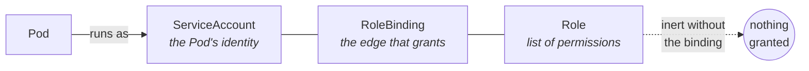

# Chapter 12: Configuration, Identity, and Security

Your service is running, surviving machine failures, sharing resources sensibly, and
staying available through maintenance. It is also, at this point, useless, because
it has no idea what database to connect to, no password to connect with, no identity
of its own, and no rules about who may talk to it.

This chapter closes the machine. It is three subjects that people usually meet
separately, and they belong together because they answer three versions of the same
question: *what does this program get to know, what is it allowed to do, and who is
allowed to reach it?*

Each has a characteristic failure that produces silence rather than an error, which
by now you will recognise as the theme of everything in production.

## Configuration: getting settings into a container

Chapter 5 established that a container image is immutable: a frozen,
content-addressed stack of layers. That is what makes it reproducible, and it is why
configuration is a problem. The same image has to run in your test environment and in
production, pointing at different databases, with different log levels. If you bake
those settings into the image you need a different image per environment, which
destroys the reproducibility that made images valuable: you would no longer be
promoting *the tested artefact* to production, you would be building a new, untested
one. So settings must arrive from outside, at the moment the container starts.

Kubernetes gives you two objects for this, and they are near-identical twins with one
important difference.

A **ConfigMap** holds non-sensitive configuration as key-value data: log levels,
feature flags, hostnames, whole configuration files. A **Secret** holds the sensitive
equivalent: passwords, tokens, certificates, connection strings.

Both reach a container in one of two shapes, and the choice has real consequences:

**As environment variables.** Convenient, works with every language, and read once at
process start. That last part matters: an environment variable is a *copy* taken at
startup. Change the ConfigMap afterwards and the running container keeps the old
value forever, until something restarts it.

**As files mounted into the filesystem.** The container reads them like any other
file. These *can* be updated while the container runs (Kubernetes refreshes the
mounted contents after a change), though the program has to be written to notice, by
re-reading the file or watching for changes. This is the shape you want for large
configuration files, for certificates, and for anything you hope to rotate without a
restart.

### The honest truth about Secrets

A Secret is not encrypted. By default it is stored *base64-encoded*, which is an
encoding, not encryption: it is trivially reversible by anyone who can read the
object, and it exists to allow arbitrary bytes in a text field, not to protect
anything. Treating base64 as a security measure is one of the most common
misunderstandings in this space.

What actually protects a Secret is everything around it: whether the cluster is
configured to encrypt data at rest in its datastore, and, much more importantly,
who is permitted to read Secret objects at all. Which is the next section's subject,
and the reason these two topics belong in one chapter. In serious environments,
secrets are usually not stored in Kubernetes at all: an external secrets manager holds
them, and an operator syncs them in, so that the durable source of truth lives
somewhere purpose-built and auditable.

### The failure that produces silence

The characteristic configuration failure is a reference to something that does not
exist. A container asks for a ConfigMap or Secret by *name* (a plain string), and if
nothing by that name exists in the right place, the container cannot start. You get a
Pod stuck in an error state with a message about failing to create the container, and
the cause is a typo, or a resource that lives in a different namespace, or a key that
was renamed on one side and not the other.

The variation that is genuinely nasty: referencing a *key* that does not exist within
a Secret or ConfigMap that *does*. Depending on how it is consumed, the container may
start perfectly happily with the variable simply absent, and your program discovers
at its first database call, in production, that its connection string is an empty
string. The object existed. The reference resolved. The key did not, and nothing
checked.

## Identity: who is this program?

Programs sometimes need to talk to Kubernetes itself: to discover other services, to
read configuration, to react to changes. So a Pod needs an identity the API server can
recognise and make decisions about.

That identity is a **ServiceAccount**. Every Pod runs as one; if you do not specify it,
it runs as the namespace's `default` account. A credential for that account is mounted
into the container automatically, so any code inside can present it when calling the
API server.

Two consequences worth internalising. First, "I didn't configure an identity" does not
mean "this Pod has no identity"; it means it has the *default* one, whatever
permissions that has accumulated in your cluster, which is a considerably worse
position than a deliberate choice. Second, since a credential is mounted by default
even into the overwhelming majority of Pods that never call the API at all, that is a
token sitting in the filesystem of every container you run, available to anything that
compromises it. Turning that off for workloads that do not need it is one of the
cheapest security improvements available.

## Permissions: RBAC and the binding you will forget

Having an identity says nothing about what it may *do*. That is decided by
**role-based access control**, or **RBAC**, and its structure is the thing to
understand, because its most common failure comes directly from that structure.

There are two halves, and they are separate objects.

A **Role** is a list of permissions: these verbs (get, list, watch, create, delete) on
these kinds of resources. A Role is namespace-scoped; its cluster-wide equivalent is a
**ClusterRole**.

A **RoleBinding** connects a Role to one or more subjects: a ServiceAccount, a user, a
group. Its cluster-wide equivalent is a **ClusterRoleBinding**.

Now the critical property, stated as plainly as the documentation does: **a Role grants
nothing whatsoever until it is bound.** A Role is a *description* of permissions, inert
on its own. The binding is what actually confers them on somebody. Permissions are not
a property of the Role; they are a property of the *edge* between a Role and an
identity.

So the classic failure: someone writes a carefully-scoped Role with exactly the right
permissions, deploys it, and forgets the RoleBinding, or writes one that names the
wrong ServiceAccount, or the right name in the wrong namespace. Everything applies
cleanly. Nothing complains. The Role sits there, valid and useless. And the failure
surfaces only when the application makes its first API call and receives a `403
Forbidden`, possibly weeks later, on a code path that only runs during failover.

The mirror-image mistake is over-granting, usually by wildcard. A rule with `verbs:
["*"]` or `resources: ["*"]` does not merely grant a lot; it grants everything
*including resource types that do not exist yet*. Install a new component next year
that introduces a new resource kind, and every wildcard rule silently expands to cover
it. That is a property of how RBAC matching works, and it is why wildcards age badly
in a way that explicit lists do not.

## Reachability: NetworkPolicy and the default that flips

The last question is who may talk to your service over the network. Chapter 9
established the model: a flat network where **every Pod can reach every other Pod**.
That is a wonderfully simple foundation and a poor security posture: it means a
compromise anywhere can reach anything.

**NetworkPolicy** objects restrict that. A policy selects a set of Pods and declares
which traffic is allowed to reach them and which they may send. The mechanism has one
property that is responsible for nearly every surprise it produces, so let us be
exact about it.

**Policies are additive, and selection flips the default.** With no policy selecting a
Pod, all traffic is allowed. The moment a policy selects that Pod *for a direction*,
the default for that direction inverts: everything not explicitly permitted is now
denied. There is no "deny" rule to write, and no ordering or precedence to reason
about: the presence of a policy is itself the denial, and the rules inside it are the
exceptions.

Note the phrase "for a direction," because the two directions are tracked separately.
Traffic coming *in* to a Pod is **ingress**; traffic the Pod sends *out* is **egress**.
A Pod can be isolated for one and wide open for the other, and the documentation states
the test for each in the same shape: a Pod "is isolated for ingress if there is any
NetworkPolicy that both selects the pod and has `Ingress` in its `policyTypes`," and
likewise for egress. So isolation is not a property of being selected. It is a property
of being selected *by a policy that names that direction*.

Which brings us to a footgun that is written into the API's own defaulting rule, and
that catches careful people. Your service is working. Someone adds a policy whose only
purpose is to restrict *outbound* traffic (say, to stop the service calling anything
except one specific API). They select your Pods, write egress rules, and, reasonably
enough, do not bother filling in a `policyTypes` field they have no opinion about.

Your service immediately stops receiving requests.

Why? Because of this sentence in the documentation, which is easy to read past:

> "If no `policyTypes` are specified on a NetworkPolicy then by default `Ingress` will
> always be set and `Egress` will be set if the NetworkPolicy has any egress rules."

Read it slowly. `Ingress` is set **always**: not "if there are ingress rules," not "if
you asked for it." Always. So the policy the author intended as egress-only is stored
with *both* directions in `policyTypes`. The Pod is now isolated for ingress, and the
policy contains no ingress rules, which under a default of deny means no permitted
sources at all. Nothing in what the author wrote *mentions* inbound traffic. That is
exactly the problem: with a default of deny, silence means no.

The fix is one line (write `policyTypes: ["Egress"]` explicitly), and the lesson is
larger than the fix. An omitted field is not a neutral field. It is a field whose value
someone else chose for you, and here the value chosen is the one that denies.

And a second, larger trap sits underneath all of this: **NetworkPolicy objects only do
anything if the cluster's networking plugin implements them.** Chapter 9 noted that
Kubernetes defines the network contract and delegates it to a plugin. Policy
enforcement is part of that delegation. Install a plugin that does not enforce policy,
and every NetworkPolicy you write is accepted by the API server, stored, displayed,
and *completely inert*. You have a beautiful set of security rules and no security. No
warning is issued, because from the API server's point of view nothing is wrong.

## The shape of all three failures

Look at what configuration, permissions, and reachability have in common:

- A reference to a **name** that may not exist (a ConfigMap, a Secret, a key).
- A permission that exists but is not **connected** to the identity that needs it.
- A rule that is present but not **enforced**, or that silently denies by omission.

All three are the pattern you can now name on sight: **valid objects, broken graph,
silence**: failing at first API call, first failover, first traffic.

## Where Syg stands

Syg's response to this chapter is mostly to change what you are able to write. You do
not reference a ConfigMap or Secret by string; you reference a *declaration*, so a
name that does not exist is a compile error at your source line rather than a Pod
stuck in an error state ([`missing-config`](../rules/prevented.md#missing-config),
[`missing-secret`](../rules/prevented.md#missing-secret)), and the keys you consume are checked against
the keys that declaration actually defines ([`missing-key`](../rules/config.md#missing-key)), which
catches the nastier silent-empty-variable case. Secrets are declared as *keys only*,
never values, because values belong in a secrets manager and never in source.

For permissions, Syg derives the whole binding chain from one `identity` declaration
(the account, the role, and the binding that connects them), so the forgotten
RoleBinding becomes structurally impossible rather than a check that has to notice its
absence ([`identity-missing`](../rules/prevented.md#identity-missing),
[`unbound-permissions`](../rules/prevented.md#unbound-permissions)). Wildcards are flagged
([`wildcard-permission`](../rules/identity.md#wildcard-permission)) on
the grounds you now understand: they silently expand to cover resources that do not
exist yet.

And the honest limit, which matters as much as the capabilities: Syg **cannot** tell
you whether your cluster's networking plugin actually enforces NetworkPolicy. That is
a fact about a running cluster, not about your source code, and Syg refuses to
pretend otherwise: it is a check that requires a captured snapshot of a real cluster
([`policy-not-enforced`](../rules/cluster.md#policy-not-enforced)), and until such a snapshot is supplied
it is reported as
*skipped* rather than passed. A tool that told you "network policy verified" without
knowing whether anything enforces it would be worse than no tool at all.

## Read the source

- **ConfigMaps** and **Secrets**, including the explicit statement that Secrets are
  base64-encoded rather than encrypted:
  https://kubernetes.io/docs/concepts/configuration/configmap/ and
  https://kubernetes.io/docs/concepts/configuration/secret/
- **RBAC**: Roles, ClusterRoles, and the bindings that actually grant them:
  https://kubernetes.io/docs/reference/access-authn-authz/rbac/
- **ServiceAccounts** and how Pods get an identity:
  https://kubernetes.io/docs/concepts/security/service-accounts/
- **Network Policies**: the additive model, "the two sorts of pod isolation," and the
  `policyTypes` defaulting rule quoted above:
  https://kubernetes.io/docs/concepts/services-networking/network-policies/
- **Encrypting secret data at rest**: what it takes to make stored Secrets actually
  protected: https://kubernetes.io/docs/tasks/administer-cluster/encrypt-data/

---

*The machine is now complete. You understand every layer from the Linux kernel to the
permission graph. Which puts you in a position to ask the question these notes have
been walking toward: given that all of this is configured through text files, why has
configuring it become so painful, and what have people tried to do about it?* →
[Why YAML hurts](../notes/13-why-yaml-hurts.md)
